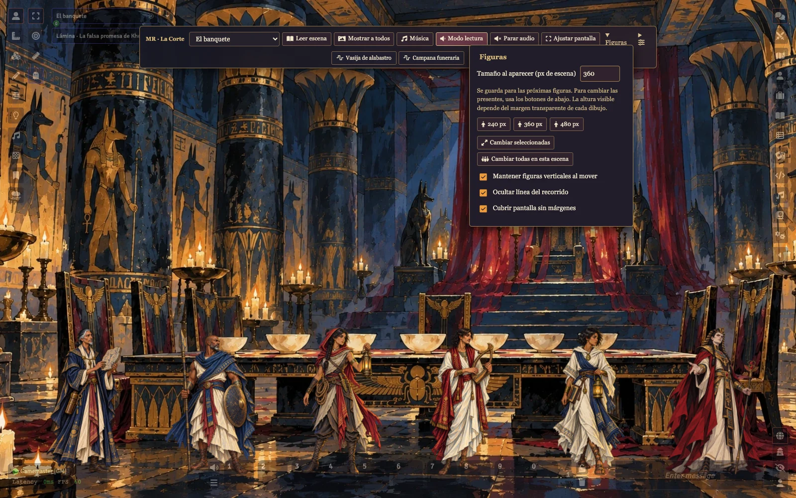
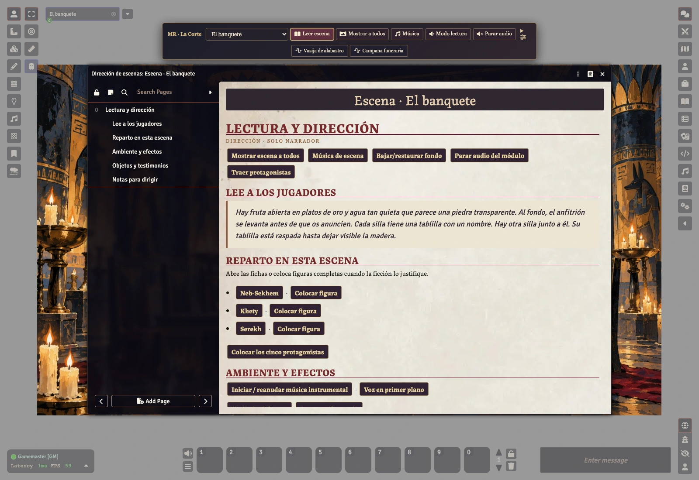
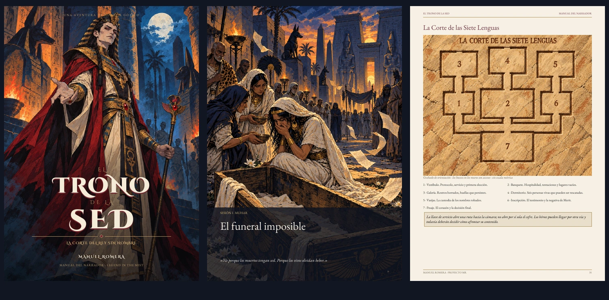
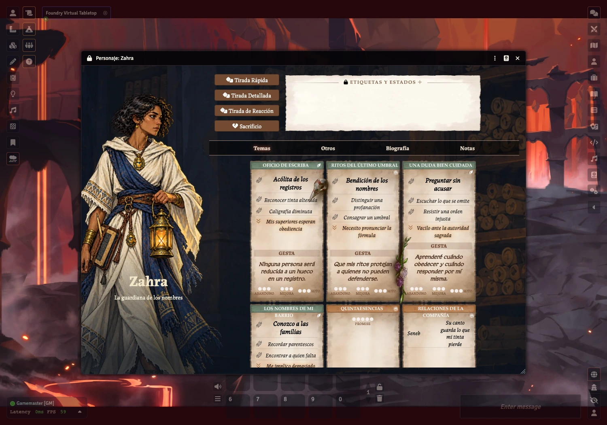

<p align="center"></p>

<p align="center">
<a href="https://github.com/ManuRomera/mr-trono-de-la-sed/releases/latest"></a>


<a href="https://github.com/ManuRomera/mr-trono-de-la-sed/releases"></a>
<a href="LICENSE"></a>
</p>

<h3 align="center">El ataúd está vacío. Nadie recuerda el nombre del difunto.<br>Bajo la arena, un rey conserva todo aquello que los demás han olvidado.</h3>
<p align="center"><b>Horror gótico · identidad · memoria · duelo</b><br><sub>4–5 protagonistas · tres sesiones de unas dos horas · en español</sub></p>
<p align="center"><a href="https://github.com/ManuRomera/mr-trono-de-la-sed/releases/latest"><b>⬇️ Descargar</b></a> · <a href="https://github.com/ManuRomera/mr-trono-de-la-sed/releases/latest/download/El-Trono-de-la-Sed-Manual.pdf"><b>📖 Manual</b></a> · <a href="https://github.com/ManuRomera/mr-trono-de-la-sed/releases/latest/download/El-Trono-de-la-Sed-Material-de-Juego.pdf"><b>🎒 Material de juego</b></a> · <a href="#instalar"><b>⚡ Instalar</b></a></p>

## ⚡ Instalar

Necesitas **Foundry VTT v13** y el sistema oficial gratuito **mist-engine-fvtt 14.5.4**. El módulo comercial de libros no es necesario. En **Add-on Modules → Install Module → Manifest URL**, pega:

```text
https://github.com/ManuRomera/mr-trono-de-la-sed/releases/latest/download/module.json
```

Activa **MR · El Trono de la Sed** en un mundo del sistema. En un mundo vacío, acepta la importación que ofrece el Narrador. En un mundo existente, entra en **Configuración → MR · El Trono de la Sed → Libro de los Muertos → Importar la aventura**. Asigna cada protagonista a su jugador; la compañía ya está vinculada.

Si instalas a mano, reemplaza la carpeta completa del módulo en lugar de mezclar archivos de compendios de dos versiones. Al actualizar desde una edición local, reimporta para añadir las lecturas de escena y las listas de audio. Los documentos existentes se conservan. Los nuevos enlaces de dirección completan únicamente campos vacíos; tus diarios, imágenes, música personalizada y progreso permanecen intactos.

## 🖥️ Dirigir desde la escena

La **barra del Narrador** aparece arriba, en el centro. Su selector permite ver una escena en privado. **Mostrar a todos** la activa para la mesa y arranca su música instrumental. **Leer escena** abre el diario privado con el texto preparado para leer en voz alta.

Desde ese diario puedes iniciar la música, reducirla con **Modo lectura**, disparar efectos, abrir las fichas de personajes y PNJ, colocar sus figuras y acceder a los objetos de la escena. Colocar otra vez un mismo personaje no duplica el token. Los efectos en bucle se apagan al pulsarlos de nuevo; también puedes detenerlos por separado.

El menú de la barra ajusta el volumen, trae a los cinco protagonistas y abre el Libro del Narrador. **Parar audio** detiene solo las pistas de este módulo. Los jugadores conservan sus controles de volumen de Foundry. La barra es exclusiva del Narrador.

<p align="center"></p>
<p align="center"></p>

## 📖 Una aventura para jugar

En Muhar, la ausencia de un nombre se convierte en una investigación sobre seis personas desaparecidas. La corte que aguarda bajo la arena ofrece hospitalidad, conocimiento y la posibilidad de recuperar lo perdido. Cada regalo tiene una intención. Las elecciones de los protagonistas determinan qué nombres, testimonios y vínculos sobreviven.

- **Manual de 50 páginas** y **cuaderno de protagonistas de ocho páginas**, con ayudas y fichas listas para usar.
- Cinco héroes nativos con cuatro temas cada uno, mochila, relaciones y tema compartido; 34 actores en total.
- 29 escenas y sus diarios de dirección, con pistas redundantes, negociación, rescate y seis desenlaces abiertos.
- 68 ilustraciones de una misma colección; 22 siluetas completas transparentes para personajes y criaturas.
- Mapas de orientación grabados sobre piedra, escenas sin cuadrícula y nueve páginas de arte completo en el manual.
- **Nueve bucles instrumentales** y **diez efectos y ambientes sin voces**, incluidos en el módulo y disponibles sin conexión.
- Libro de los Muertos: campaña, nombres cautivos, sellos, corazón, pistas y panel del vampiro.
- Libro de los Recuerdos: recuerdos de cada protagonista y lectura de sus estados oficiales.
- Tutoriales del Narrador y los jugadores. No añade puntos de golpe ni otro motor de tiradas.

<p align="center"></p>
<p align="center"></p>

## 🎵 Sonido al servicio de la voz

Muhar al atardecer, viento entre las tumbas, procesión, Laberinto, banquete, Merit, pesaje, coronación y último amanecer tienen su propio ambiente musical. Son piezas instrumentales de **Kevin MacLeod**, adaptadas a bucle con solapamiento y normalizadas para fondo. Los efectos incluyen viento, antorchas, piedra, campana, vasijas, corazón, sellos, pluma, pasos y agua.

Las piezas conservan su licencia **CC BY 4.0** y su atribución en [AUDIO-CREDITS.md](AUDIO-CREDITS.md), en el manual y en un diario del módulo. Los efectos son síntesis originales sin voces. No hay pistas vacías ni dependencia de servicios de reproducción externos.

## 🗝️ Preparar la mesa

Comparte únicamente el cuaderno inicial con los jugadores. Entrega a cada participante su secreto personal; las ayudas del misterio se revelan durante la partida. **Alt+B** abre el Libro de los Muertos y **Alt+M**, los recuerdos. Las etiquetas, estados y capacidades se seleccionan en las fichas oficiales.

Las notas privadas de campaña se guardan cifradas, con clave en el navegador del Narrador. Usa localhost o HTTPS y descarga un respaldo privado desde la guía antes de cambiar de equipo o borrar los datos del navegador. Ese respaldo contiene tus notas legibles: consérvalo como material privado.

## 🛠️ Fuentes y validación

Los diarios y PDF se generan desde `content/narrative.json`; `content/direction.json` enlaza cada escena con su lectura, reparto y sonido. Los documentos nativos proceden de `content/actors.json` y `content/items.json`. Los assets de pantalla y audio están incluidos en el repositorio; no necesitas generar imágenes ni descargar música para instalar.

```sh
npm ci
python3 -m pip install -r requirements.txt
npm test
python3 tools/maps.py
python3 tools/content.py
python3 tools/verify.py
python3 tools/pdf.py
npm run build
```

La edición digital se prueba en Foundry 13.351 con Mist Engine 14.5.4. Las comprobaciones automatizadas y las capturas están en `docs`. No se ha realizado una prueba de mesa con un grupo ni una tirada de imprenta a doble página.

## Créditos y licencia

Aventura de **Manuel Romera**. Publicada por indicación del autor y su declaración de permisos. Proyecto independiente, sin presentarse como producto oficial de Wizards of the Coast, Son of Oak o Foundry VTT. Las marcas y ambientaciones pertenecen a sus titulares.

Las aportaciones originales del Proyecto MR se ofrecen bajo **CC BY-NC-SA 4.0**. La música y las tipografías conservan sus licencias propias; véanse [NOTICE.md](NOTICE.md), [LICENSE](LICENSE) y [créditos musicales](AUDIO-CREDITS.md). Se han utilizado herramientas de IA para texto, programación e ilustración.

## 🇬🇧 English

**The Throne of Thirst — The Court of the Nameless King** is a Spanish gothic horror adventure for **Legend in the Mist** in **Foundry VTT 13**. It includes five native heroes, a shared fellowship, a 50-page Narrator book, an eight-page player booklet, 29 illustrated scenes with linked reading journals, nine instrumental music loops, ten sound effects and ambiences, and a central Narrator toolbar.

Install the manifest above, activate the module in a world using **mist-engine-fvtt 14.5.4**, and accept the adventure import. Existing documents and campaign progress are preserved. Scene journals provide reading text, music, effects, character sheets and token placement. Original MR contributions use CC BY-NC-SA 4.0; music uses CC BY 4.0 and fonts use SIL OFL. Full third-party notices are included. Adventure text is Spanish; interface controls include English translations.
