<p align="center">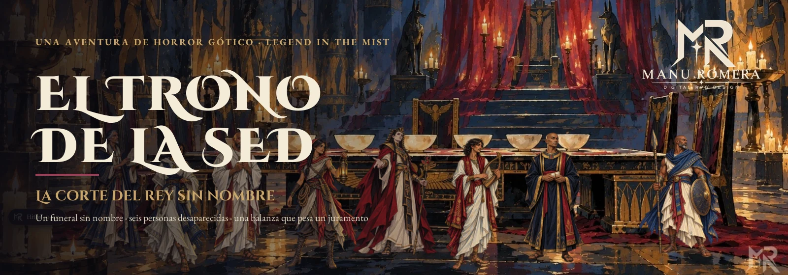</p>

<p align="center">
<a href="https://github.com/ManuRomera"></a>
  <a href="https://github.com/ManuRomera/mr-trono-de-la-sed/releases/latest"></a>


<a href="https://github.com/ManuRomera/mr-trono-de-la-sed/releases"></a>
<a href="LICENSE"></a>
</p>

<h3 align="center">El ataúd está vacío. Nadie recuerda el nombre del difunto.<br>Bajo la arena, un rey conserva todo aquello que los demás han olvidado.</h3>
<p align="center"><b>Horror gótico · identidad · memoria · duelo</b><br><sub>4–5 protagonistas · tres sesiones de unas dos horas · en español · Foundry VTT v13</sub></p>
<p align="center"><a href="https://github.com/ManuRomera/mr-trono-de-la-sed/releases/latest"><b>⬇️ Descargar</b></a> · <a href="https://github.com/ManuRomera/mr-trono-de-la-sed/releases/latest/download/El-Trono-de-la-Sed-Manual.pdf"><b>📖 Manual (PDF)</b></a> · <a href="https://github.com/ManuRomera/mr-trono-de-la-sed/releases/latest/download/El-Trono-de-la-Sed-Material-de-Juego.pdf"><b>🎒 Cuaderno de jugadores</b></a> · <a href="https://github.com/ManuRomera/mr-trono-de-la-sed/releases/latest/download/El-Trono-de-la-Sed-Tarjetas-de-PNJ.pdf"><b>🃏 Tarjetas de PNJ</b></a> · <a href="#-instalar"><b>⚡ Instalar</b></a></p>

---

<p align="center">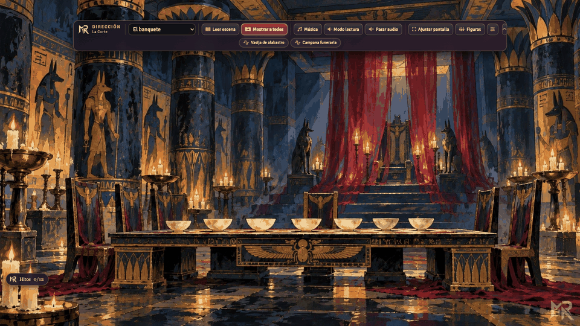</p>

## 🕯️ La aventura

En Muhar, una ciudad de adobe del desierto, empiezan a desaparecer personas. Después desaparece el recuerdo de que alguna vez existieron: una taza de más, un renglón en blanco, una sandalia sin dueño. Un funeral al que le falta el nombre del difunto, una procesión que baja a una tumba y una invitación a cenar conducen a la **Corte de las Siete Lenguas**, donde un príncipe cortés llama amor a su negativa a dejar marchar a los muertos.

Seis personas siguen vivas. Un séptimo nombre puede abrir una prisión milenaria. Y una mujer que dijo *no* hace siglos todavía espera a que alguien lo recuerde. **La decisión final pertenece a los héroes.**

| | |
|---|---|
| **Sesión I · Muhar** | Un funeral imposible, una investigación en cuatro puertas y un cortejo que baja al pozo. |
| **Sesión II · La Corte** | Un banquete donde cada invitado recibe la tentación que le corresponde, seis cautivos y seis vasijas. |
| **Sesión III · La Cámara del Pesaje** | Un sacerdote de rodillas, una balanza que pesa un juramento y seis desenlaces posibles. |

Para **Legend in the Mist** (sistema oficial gratuito [`mist-engine-fvtt`](https://foundryvtt.com/packages/mist-engine-fvtt)); no añade puntos de golpe ni otro motor de tiradas.

## 🎬 Dirige desde la escena

La **barra del Narrador** vive sobre el lienzo y reúne lo que necesitas durante la sesión: elegir escena, **leer** el texto preparado, **mostrar** la escena a todos con su música, bajar el fondo mientras lees, lanzar efectos y ajustar las figuras.

<p align="center">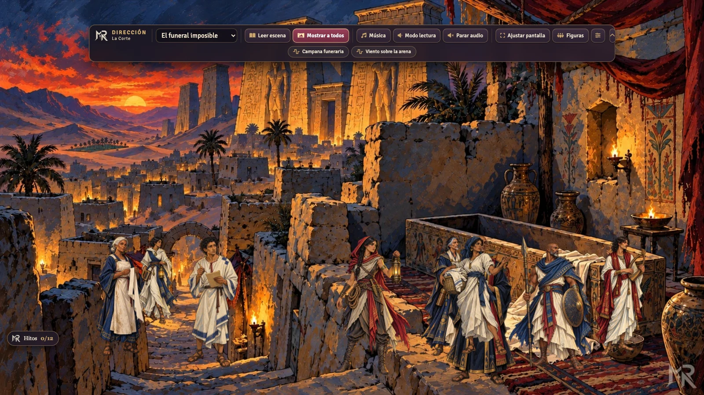</p>

- **Muévela donde quieras:** mantén pulsado el **botón derecho** sobre la barra y arrástrala. Recuerda su posición por usuario; «Centrar barra» la devuelve a su sitio.
- **Plégala** a una sola fila cuando solo necesitas elegir y mostrar escena.
- **Un botón por acción:** Leer escena · Mostrar a todos · Música · Modo lectura · Parar audio · Ajustar pantalla · Figuras. Los efectos de cada escena aparecen como botones redondos.
- **Cubrir pantalla** adapta el lienzo de cada participante sin bandas grises ni deformar el dibujo.

<p align="center">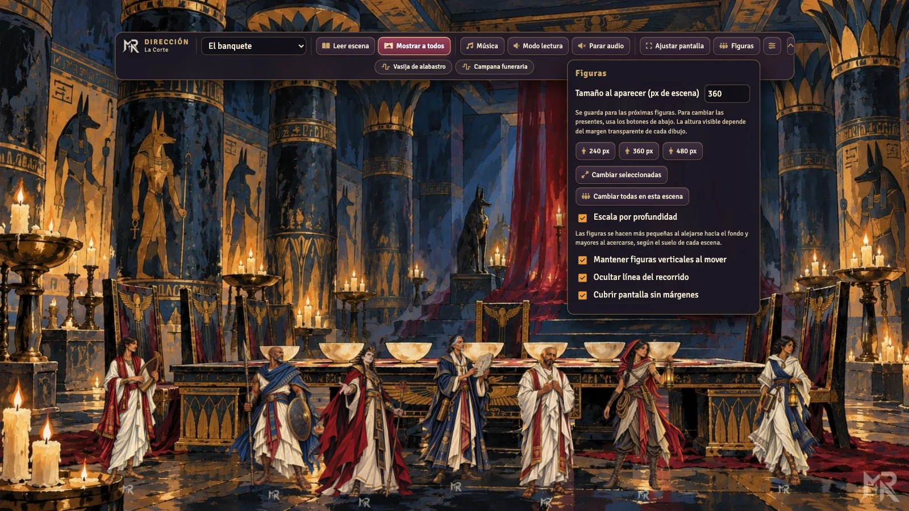</p>

## 🧍 Figuras que respetan la perspectiva

Cada fondo declara su **línea de horizonte** y los puntos donde realmente cabe una persona (solo suelo firme). Al colocar a los protagonistas y a los PNJ, cada figura pisa un lugar real de la escena y **su tamaño sale de la perspectiva del dibujo**: junto al trono se ve pequeña, ante la mesa y las sillas del banquete, a escala con ellas. Si arrastras una figura hacia el fondo, se encoge; hacia el frente, crece, conservando siempre su apoyo en el suelo. Se activa o desactiva desde **Figuras → Escala por profundidad**.

| | |
|---|---|
| 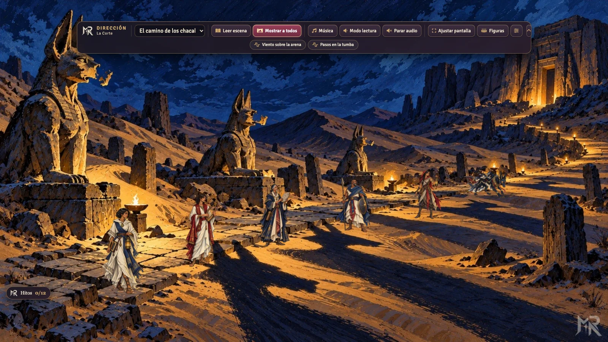 | 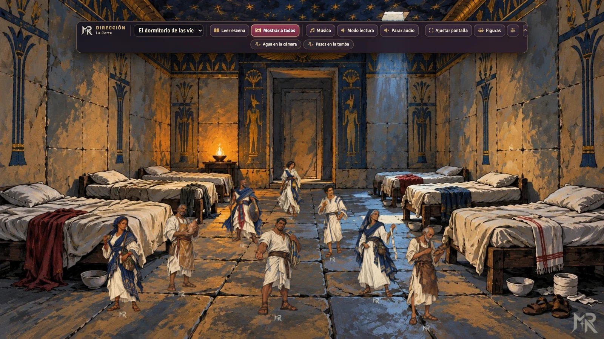 |
| 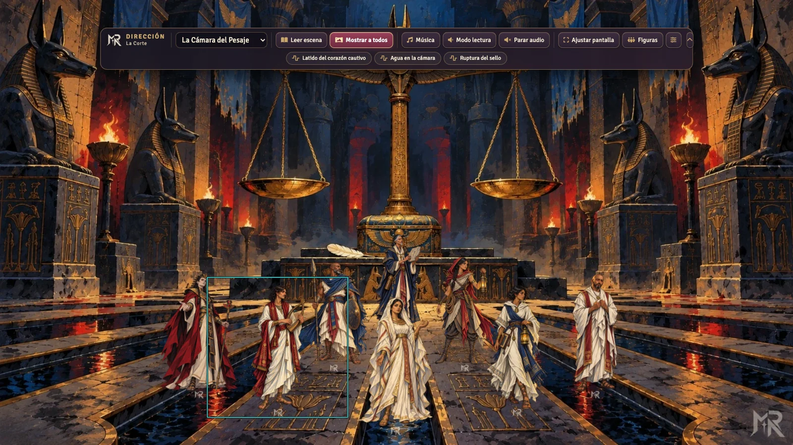 | 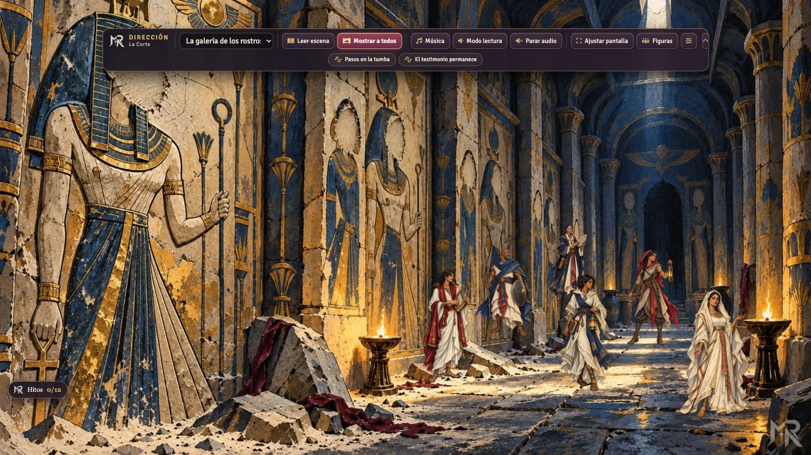 |

Los 26 fondos son de 1920 × 1080 y no llevan personajes integrados; las 22 siluetas completas, transparentes, llevan la marca **MR** diminuta cosida en la ropa.

## 👑 Un dios y su corte

Neb-Sekhem no es un villano al que se derrota: es un **rey que se cree dios**, y la aventura está escrita para que la mesa se sienta pequeña ante él (demostraciones de poder, la corte que se inclina, la sed). Un **reloj de siete lámparas** da urgencia, y sus muertos —**Borrados**, **Plañideras** y **Pesadores**, de horror gótico y sin una sola momia— traen acción, persecuciones e infiltración. El capítulo de **Har’Akir** reúne los símbolos egipcios (el nombre, el corazón, la pluma, la balanza) para que todo suene a Egipto.

<p align="center">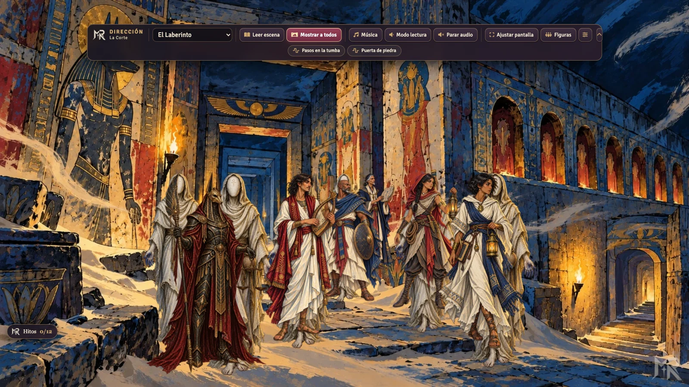</p>

El panel de hitos incluye, solo para el Narrador, el **marcador de las siete lámparas**:

<p align="center">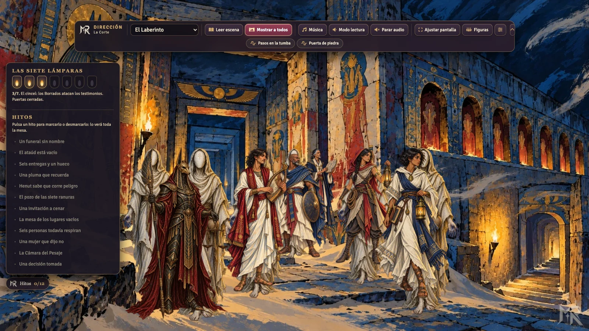</p>

## 🌘 Ambiente y hitos

<p align="center">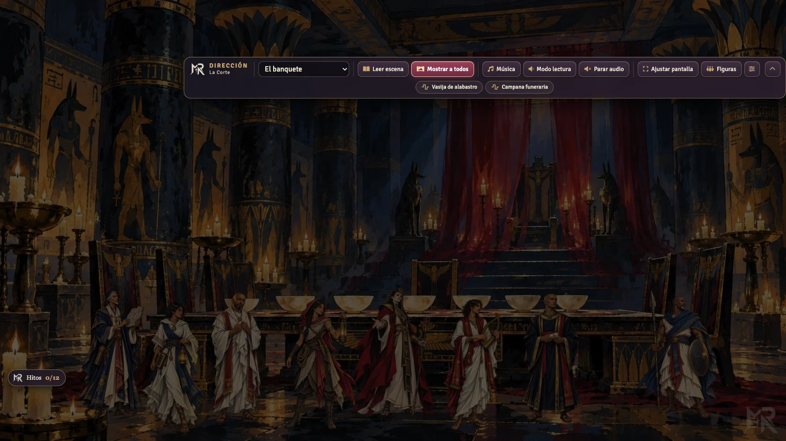</p>

- **Ambiente** (menú de la barra): *claro, penumbra u oscuro* cambian a la vez la luz de la escena y el volumen del fondo musical, y se recuerdan por escena.
- **Hitos de la investigación** (insignia abajo a la izquierda o **Alt+H**): doce descubrimientos sin spoilers que marca el Narrador. Toda la mesa ve el progreso y recibe un aviso con cada hito nuevo; sirven de pausa natural al cierre de una escena.

<p align="center">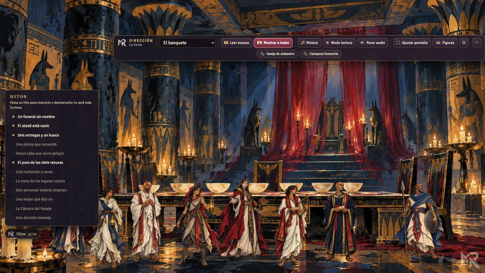</p>

## 🎓 Tutoriales guiados

Tres recorridos nativos de Foundry (Configuración → MR · El Trono de la Sed → Tutoriales): **Narrador** (libros), **dirección de escena** (mover la barra, figuras con profundidad, ambiente y hitos) y **jugadores** (recuerdos e hitos).

<p align="center">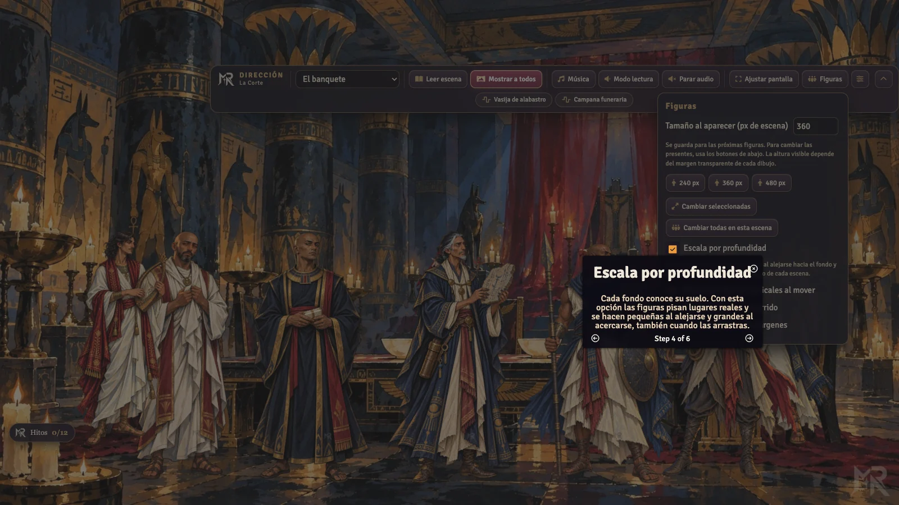</p>

## 📖 Diarios, libros y fichas

<p align="center">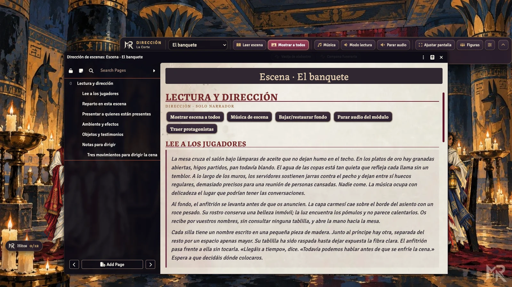</p>

Cada escena tiene su **diario de dirección**: el texto para leer en voz alta, los accesos a música y efectos, las fichas del reparto, las presentaciones de cada persona presente, los objetos y las notas para dirigir. Todo el texto sale de la misma fuente que el manual, así que nunca se contradicen.

| | |
|---|---|
| 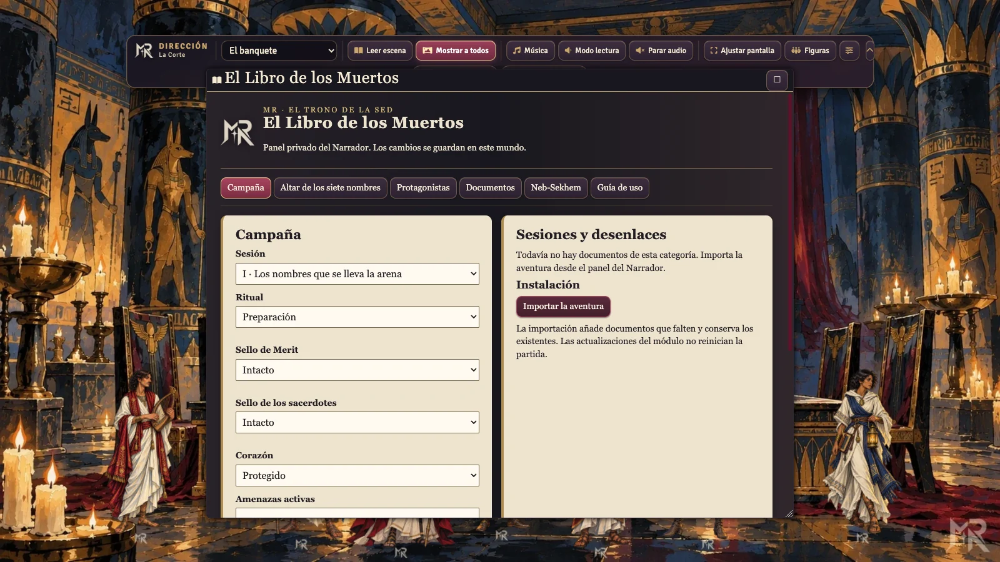 | 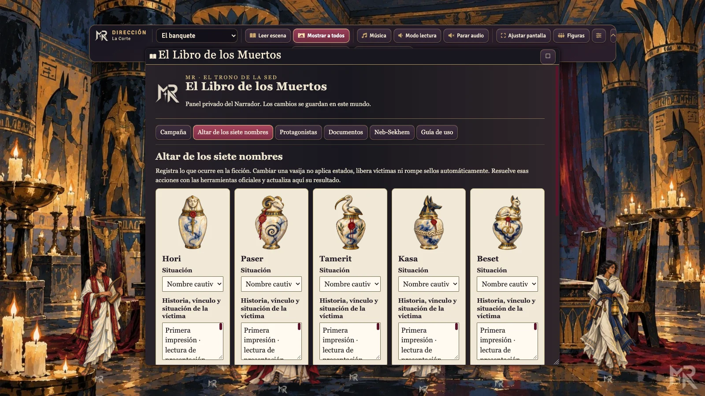 |

- **Libro de los Muertos** (Alt+B): campaña, altar de los siete nombres, protagonistas, documentos, panel de Neb-Sekhem y guía de uso.
- **Libro de los Recuerdos** (Alt+M): los recuerdos de cada protagonista y sus estados oficiales.

<p align="center">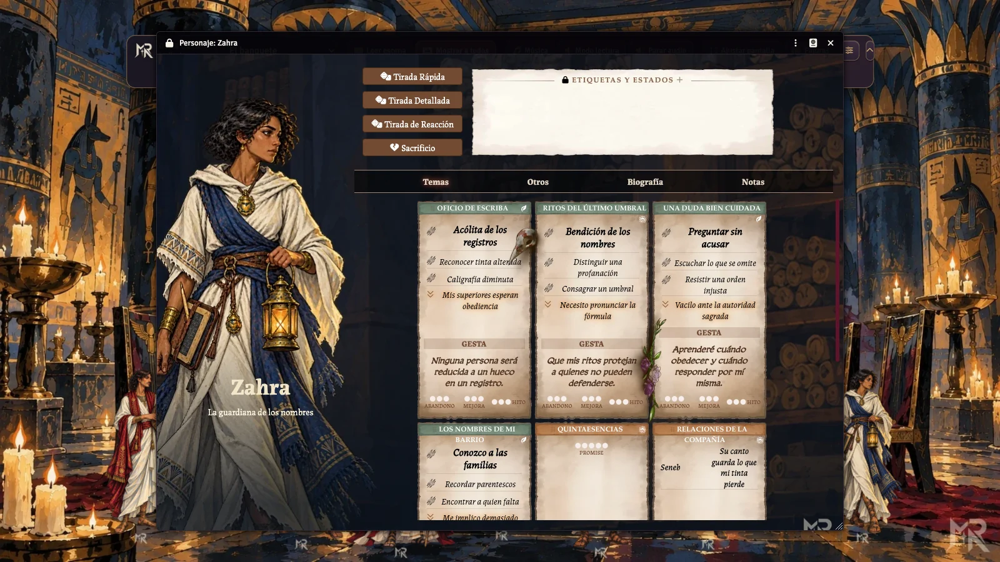</p>

Cinco héroes nativos con cuatro temas cada uno, mochila, relaciones y tema compartido; 34 actores en total, todos con las fichas oficiales del sistema.

## 📚 Un manual a la altura

<p align="center">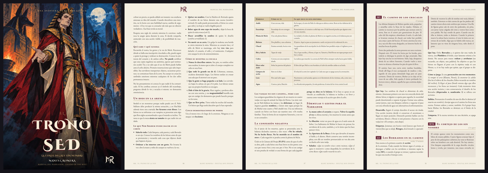</p>

El **Manual del Narrador** (87 páginas), el **cuaderno de protagonistas** (10) y las **tarjetas de PNJ** (2) están escritos y maquetados como una gran campaña gótica: introducción con «Cómo describir el horror», capítulo del villano con sus metas y su forma de interpretarlo, lugares con clave (M1–M7, C1–C6, P1–P5) y bloques fijos *Qué hay · Qué quieren · Pistas · Desarrollo · Etiquetas · Riesgos*, tarjetas de personaje, acontecimientos especiales, seis finales, tablas aleatorias y la **Lectura de la Arena**, que cambia tres hechos de la partida para que no se repita. Texto justificado y guionado en español, cajas de lectura, planos grabados en piedra y documentos para entregar. Cada release incluye además las **tarjetas de PNJ recortables** (6 por A4, con retrato) y una **edición de imprenta** con 3 mm de sangrado.

## 🎵 Sonido al servicio de la voz

Muhar al atardecer, viento entre las tumbas, procesión, Laberinto, banquete, Merit, pesaje, coronación y último amanecer tienen su propio ambiente musical. Son piezas instrumentales de **Kevin MacLeod**, adaptadas a bucle con solapamiento y normalizadas para fondo. Los efectos incluyen viento, antorchas, piedra, campana, vasijas, corazón, sellos, pluma, pasos y agua.

**Doce motivos** (batalla, combate oscuro, persecución, sigilo, tensión, horror, el rey sin nombre, amenaza creciente, misterio, duelo, esperanza y latido) se lanzan desde el menú «Motivos» de la barra del Narrador. Todas las transiciones usan un **fundido cruzado de 3,5 s sin hueco**, incluso al repetir la pista, y los bucles no tienen costura. La **insignia de hitos** se arrastra con el botón derecho y recuerda dónde la dejaste. Las 13 **ayudas** llegan como piezas ilustradas (carta, lino, rollo, cuaderno…) con el texto ya compuesto, y las escenas traen su miniatura.

Las piezas conservan su licencia **CC BY 4.0** y su atribución en [AUDIO-CREDITS.md](AUDIO-CREDITS.md), en el manual y en un diario del módulo. Los efectos son síntesis originales sin voces. No hay pistas vacías ni dependencia de servicios de reproducción externos.

## 🎒 Primeros pasos

Al activar el módulo en un **mundo vacío**, el Narrador recibe la importación de la aventura y puede seguir el **tutorial guiado** (siete pasos para el Narrador, seis para los jugadores). Después: abre el Libro de los Muertos con **Alt+B**, elige una escena en la barra y pulsa **Mostrar a todos**.

### 🗝️ Preparar la mesa

Comparte únicamente el cuaderno inicial con los jugadores. Entrega a cada participante su secreto personal; las ayudas del misterio se revelan durante la partida. **Alt+B** abre el Libro de los Muertos y **Alt+M**, los recuerdos. Las etiquetas, estados y capacidades se seleccionan en las fichas oficiales.

Las notas privadas de campaña se guardan cifradas, con clave en el navegador del Narrador. Usa localhost o HTTPS y descarga un respaldo privado desde la guía antes de cambiar de equipo o borrar los datos del navegador. Ese respaldo contiene tus notas legibles: consérvalo como material privado.

## ⚡ Instalar

Necesitas **Foundry VTT v13** y el sistema oficial gratuito **mist-engine-fvtt 14.5.4**. El módulo comercial de libros no es necesario. En **Add-on Modules → Install Module → Manifest URL**, pega:

```text
https://github.com/ManuRomera/mr-trono-de-la-sed/releases/latest/download/module.json
```

Activa **MR · El Trono de la Sed** en un mundo del sistema. En un mundo vacío, acepta la importación que ofrece el Narrador; en un mundo existente, entra en **Configuración → MR · El Trono de la Sed → Libro de los Muertos → Importar la aventura**. Asigna cada protagonista a su jugador; la compañía ya está vinculada. Si instalas a mano, reemplaza la carpeta completa del módulo en lugar de mezclar archivos de dos versiones.

## 🛠️ Fuentes y validación

El texto vive en `content/manual/*.md` (Markdown propio, un fichero por capítulo). `python3 tools/manual.py --sync` lo convierte en `content/narrative.json`, `readings.json` y `direction.json`, de modo que los diarios de Foundry y el PDF comparten una sola fuente; `python3 tools/manual.py` compone ambos PDF con Chrome. `content/stage.json` declara la zona de suelo y los puntos de apoyo de cada fondo, y `tools/brand.py` estampa la marca MR en las imágenes a partir de sus originales.

```sh
npm ci
python3 -m pip install -r requirements.txt
python3 tools/brand.py
python3 tools/manual.py --sync
python3 tools/content.py
python3 tools/verify.py
npm test
python3 tools/manual.py
python3 tools/pdf-validate.py
npm run build
```

La edición digital se prueba en Foundry 13.351 con Mist Engine 14.5.4. No se ha realizado una prueba de mesa con un grupo ni una tirada de imprenta a doble página.

## Créditos y licencia

Aventura de **Manuel Romera**. Publicada por indicación del autor y su declaración de permisos. Proyecto independiente, sin presentarse como producto oficial de Wizards of the Coast, Son of Oak o Foundry VTT. Las marcas y ambientaciones pertenecen a sus titulares.

Las aportaciones originales del Proyecto MR se ofrecen bajo **CC BY-NC-SA 4.0**. La música y las tipografías conservan sus licencias propias; véanse [NOTICE.md](NOTICE.md), [LICENSE](LICENSE) y [créditos musicales](AUDIO-CREDITS.md). Se han utilizado herramientas de IA para texto, programación e ilustración.

<p align="center"><picture><source media="(prefers-color-scheme: dark)" srcset="brand/MR_11_Formal_Marfil_Transparente.png"></picture></p>

## 🇬🇧 English

**The Throne of Thirst — The Court of the Nameless King** is a Spanish-language gothic horror adventure for **Legend in the Mist** in **Foundry VTT 13**: three two-hour sessions for four or five players. In the desert city of Muhar people vanish, and then the memory that they ever existed vanishes too. A funeral without a name leads to a court under the sand, to a courteous prince, and to a scale that weighs a promise.

It includes a 87-page Narrator manual written and typeset like a major gothic campaign (justified, hyphenated columns; read-aloud boxes; keyed locations; NPC cards; random tables; a *Reading of the Sand* that varies the story), a 10-page player booklet, 26 character-free 16:9 scene backgrounds with reading journals, **depth-aware tokens** (figures stand on real spots of each scene and scale with their distance), a draggable Narrator toolbar (hold the right mouse button), bright/dim/dark ambience, spoiler-free investigation milestones, nine instrumental music loops, ten sound effects, three guided tutorials, printable NPC cards and a print edition with bleed.

Install the manifest above, activate the module in a world using **mist-engine-fvtt 14.5.4** and accept the adventure import. Original MR contributions use CC BY-NC-SA 4.0; music uses CC BY 4.0 and fonts use SIL OFL. See the notices included in the repository.
